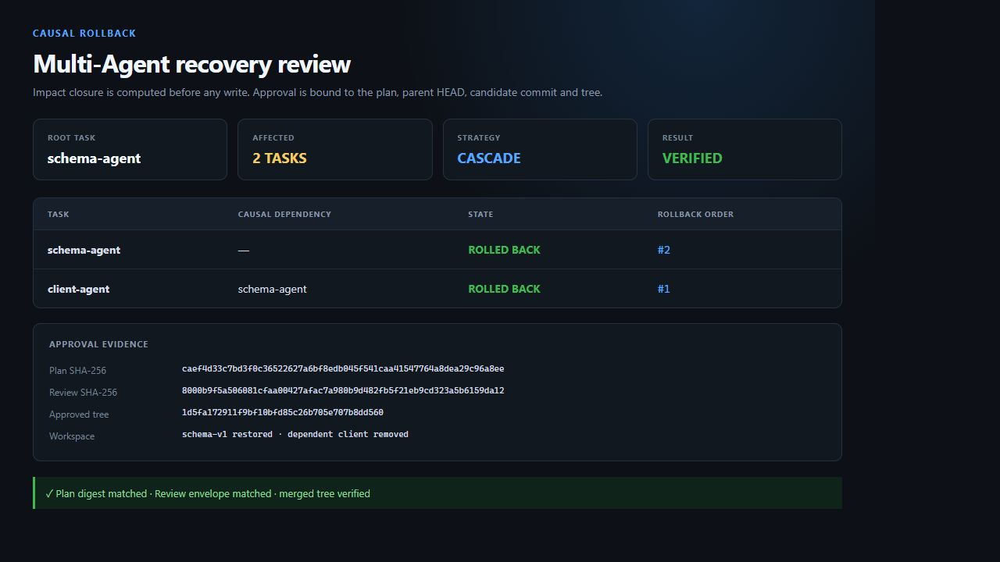

# MiniClaude

> 面向可审计长任务的轻量 AI Coding Agent，以 **Query Loop + Tool Use** 构建执行闭环，以分层恢复事务与安全 Rewind 形成自己的核心差异。

<p align="center">
  
  
  
  
</p>

<!-- 📸 截图展示区 — 替换为你自己的截图 -->
<p align="center">
  
  &nbsp;&nbsp;
  
</p>

<p align="center">
  
</p>

---

## 项目材料

- [简历项目描述](docs/RESUME_PROJECT.md)：完整版、一页压缩版、30 秒口述版及表述边界
- [完整项目介绍](docs/PROJECT_INTRODUCTION.md)：从设计动机、架构、状态机到运行验证
- [竞品对标分析](docs/COMPETITIVE_ANALYSIS.md)：Codex、Claude Code、DeepSeek Harness 的公开能力与补充路线
- [面试 QA](docs/INTERVIEW_QA.md)：100 个架构、安全、恢复、性能和边界问题
- [系统审计](docs/SYSTEM_AUDIT.md)：当前质量证据、已知限制和生产化优先级
- [项目指令、Hook 与沙箱](docs/PROJECT_INSTRUCTIONS_AND_HOOKS.md)：Stage 19 控制面语义与安全边界
- [阶段 19–21 实现与边界](docs/STAGES_19_21_IMPLEMENTATION.md)：App Server、MCP、Worktree、SDK、评测与分发
- [面试现场演示](docs/INTERVIEW_DEMO.md)：无需 Key 的恢复、冲突拒绝与 Worktree 摘要合并闭环
- [多 Agent 因果回退](docs/CAUSAL_MULTI_AGENT_ROLLBACK.md)：依赖闭包、逆拓扑补偿、重放和双摘要审批

---

## 一、技术路线

本项目采用**分层递进**的架构设计思路，自底向上分为 6 层：

```
┌──────────────────────────────────────────────────────────────────────┐
│  Layer 6: UI 层                                                       │
│  ┌─────────────┐ ┌─────────────┐ ┌─────────────┐                    │
│  │ 终端 REPL   │ │ 桌面 GUI    │ │ 启动器      │                    │
│  │ (Rich)      │ │ (Tkinter)   │ │ (Launcher)  │                    │
│  └─────────────┘ └─────────────┘ └─────────────┘                    │
├──────────────────────────────────────────────────────────────────────┤
│  Layer 5: 安全审查层                                                  │
│  规则过滤 → 工具自检 → Prompt 注入防御 → AI 风险分类 → 人工确认      │
├──────────────────────────────────────────────────────────────────────┤
│  Layer 4: 协作调度层                                                  │
│  ┌──────────────────┐  ┌──────────────────┐                         │
│  │ 中心化编排器     │  │ 子 Agent 池      │                         │
│  │ (Orchestrator)   │  │ (4 种专业角色)   │                         │
│  └──────────────────┘  └──────────────────┘                         │
├──────────────────────────────────────────────────────────────────────┤
│  Layer 3: 知识管理层                                                  │
│  ┌──────────────────┐  ┌──────────────────┐  ┌──────────────────┐   │
│  │ Skill 路由器     │  │ 记忆系统         │  │ 上下文压缩       │   │
│  │ (二阶段召回+精排)│  │ (自进化沉淀)     │  │ (四层策略)       │   │
│  └──────────────────┘  └──────────────────┘  └──────────────────┘   │
├──────────────────────────────────────────────────────────────────────┤
│  Layer 2: 执行引擎层                                                  │
│  ┌──────────────────┐  ┌──────────────────┐  ┌──────────────────┐   │
│  │ Query Loop       │  │ Tool Executor    │  │ Context Manager  │   │
│  │ (主循环)         │  │ (工具调度)       │  │ (上下文管理)     │   │
│  └──────────────────┘  └──────────────────┘  └──────────────────┘   │
├──────────────────────────────────────────────────────────────────────┤
│  Layer 1: 基础设施层                                                  │
│  ┌──────────────┐ ┌──────────────┐ ┌──────────────┐ ┌────────────┐ │
│  │ LLM Client   │ │ Tool Registry│ │ Memory Store │ │ Token      │ │
│  │ (OpenAI 兼容)│ │ (原子工具)   │ │ (SQLite)     │ │ Counter    │ │
│  └──────────────┘ └──────────────┘ └──────────────┘ └────────────┘ │
└──────────────────────────────────────────────────────────────────────┘
```

**技术路线选择依据**：
- **Query Loop + Tool Use**：借鉴 Claude Code 的核心模式，将复杂任务分解为 LLM 推理 + 工具执行的迭代闭环
- **OpenAI 兼容协议**：不绑定单一模型供应商，通过统一接口适配 MiMo-v2.5-pro 及其他模型
- **分层解耦**：每层独立可测试，便于替换和扩展（如更换 LLM 后端、新增工具类型、自定义 Skill）

---

## 二、关键技术

### 核心亮点：可恢复的代码变更事务

MiniClaude 默认不把模型修改直接写入工作区。`apply_patch_set` 先为所有旧/新路径建立 SHA-256 内容寻址备份和持久化 Journal，再把补丁放入隔离副本验证；只有目标文件仍与准备时一致才会进入提交。创建、修改、删除和重命名都产生带完整状态历史的事务收据。

提交前的冲突检测与写入由跨进程锁串行化；进程若在多文件提交中途退出，下次启动会根据 `committing` Journal 恢复全部 preimage。若现场内容既不是 preimage 也不是 postimage，则进入 `recovery_conflicted` 并保留用户内容，不盲目覆盖。`rollback_change_set` 仅在不会覆盖用户后续修改时回退，`change_transaction_status` 可查询验证证据、冲突和恢复记录。默认 Registry 不注册直接 `write_file`、`edit_file` 和 Shell 写入旁路；需要兼容旧行为时才显式关闭事务模式。详细协议与边界见 `docs/DURABLE_CHANGE_TRANSACTIONS.md`。

回退数据采用共享感知的 Mark-and-Sweep 生命周期：已提交事务默认保留 30 天，其他终态保留 7 天，活跃/恢复冲突/固定事务不会自动过期；过期 blob 先进入 trash，宽限 1 天后才解除链接。用户可先 dry-run 查看影响，再验收、固定或清理。2 GiB 硬预算不会通过牺牲未到期回退窗口来腾空间，无法安全回收时新事务会在修改工作区前失败。详见 `docs/TRANSACTION_RETENTION.md`。

2 GiB 区域现在使用 Gear 内容定义分块（16/64/256 KiB）、跨文件/跨版本块去重、按块条件 zlib 压缩和 AES-256-GCM 认证加密。恢复时逐块认证、限界解压、校验块哈希，重组后再校验完整文件 SHA-256；旧版 raw blob 保持可读。`transaction_storage_status` 可查看逻辑容量、物理容量、压缩率和去重收益。详见 `docs/CHUNKED_BACKUP_STORE.md`。

超大文件不会硬塞进 2 GiB 普通回退区。默认 256 MiB 以上文件由 `delete_files_transactionally` 流式写入独立的 24 小时加密热备区；容量或磁盘余量不足时删除会在修改原文件前失败。恢复使用临时文件、逐块认证、整文件哈希与替换后复核。`audit_transaction_recovery` 可在不写工作区的情况下报告 `available/conflicted/expired/corrupt`；提前永久清理热备必须先获取绑定事务、摘要和字节数的预览令牌，再接受一次不可缓存的人工审批。详见 `docs/LARGE_FILE_RECOVERY_VAULT.md`。

恢复本身也是一等事务：多笔变更先形成连续依赖闭包，通过 warm/hot 租约阻止 GC，在完整认证、物化和二次冲突检查后才提交；中断可补偿，未知现场进入冲突态并保留租约。原变更收据保持 committed，恢复产生独立可审计收据。每个用户 Prompt 同时是 Checkpoint，支持 code、conversation、both、summary 四种 Rewind；CLI 与桌面 Recovery Center 都会先显示健康状态和影响范围。详见 `docs/RESTORE_TRANSACTIONS.md`、`docs/PROMPT_CHECKPOINTS.md` 和 `docs/DESKTOP_CLIENT.md`。

### 2.0 BYOK 多模型配置

桌面工具栏的 **Model** 面板支持 OpenAI、DeepSeek、Anthropic、Gemini、阿里云百炼、Kimi/Moonshot 和自定义 OpenAI-compatible 服务。用户可以选择模型、填写 API Key、覆盖 Base URL，并用一次最小推理测试 Key、模型和端点是否同时可用。Provider/model/Base URL 可持久化，API Key 只驻留当前进程，不进入普通配置、事件或审计日志。详见 `docs/MODEL_PROVIDERS.md`。

### 2.1 Skill 分层路由 — 二阶段召回 + 精排

**问题**：Skill 数量增长后，全量注入 system prompt 会导致检索噪声大、Token 浪费严重。

**方案**：将工具和 Skill 分为三层组织，通过二阶段路由按需注入。

```
用户输入
   ↓
┌───────────────────────────────────┐
│ Stage 1: 粗召回 (Coarse Recall)   │  关键词匹配 + 标签过滤 + 意图分类
│  → 从 N 个 Skill 中筛选 top-10    │  时间复杂度 O(N)，毫秒级
└───────────────────────────────────┘
   ↓
┌───────────────────────────────────┐
│ Stage 2: 精排 (Fine Ranking)      │  多维评分：语义相关性 + 标签命中 +
│  → 从 10 个中选 top-3 注入 prompt │  示例相似度 + 意图关键词加分
└───────────────────────────────────┘
   ↓
注入 system prompt 的 Skill 使用指南
```

**评分公式**：`score = base_score + tag_bonus + example_bonus + intent_bonus + evidence_bonus`

Skill 现已接入 Query Loop，并使用 SQLite 保存候选、正式和废弃版本。候选版本只有在固定评测达到成功率、安全与 token 成本门槛后才能晋升；支持显式 `$skill-name`、禁用和回滚。系统不会让自动生成内容直接覆盖正式 Skill。

**三层架构**：
| 层级 | 内容 | 数量 | 注入方式 |
|------|------|------|----------|
| Atomic Tools | `read_file`, `grep_search`, `apply_patch_set` ... | 9 | 按权限注入；默认修改必须走事务 |
| High-level Skills | `code_review`, `refactor`, `debug` ... | 9 | 按需路由注入 |
| Skill Catalog | 元信息索引（标签、示例、适用边界） | - | 路由查询用 |

---

### 2.2 自进化记忆沉淀 — 闭环记忆管理

**问题**：跨会话时丢失程序性经验和用户偏好，导致重复推理。

**方案**：设计"执行 → 反思 → 提炼 → 分类存储 → 索引更新 → 按需复用"的闭环。

```
任务执行完成
     ↓
┌──────────────────────────────┐
│ Step 1: 反思 (Reflect)       │  调用 LLM 分析本次交互
│  "这次任务的关键决策是什么？"│  提取：关键决策、经验教训、用户偏好
└──────────────────────────────┘
     ↓
┌──────────────────────────────┐
│ Step 2: 提炼 (Distill)       │  将反思结果转化为结构化记忆条目
│  每条 < 200 字，自含上下文   │  包含类型标签 + 摘要
└──────────────────────────────┘
     ↓
┌──────────────────────────────┐
│ Step 3: 去重 (Deduplicate)   │  与已有记忆比对（相似度 > 0.8 则合并）
│  避免记忆冗余膨胀             │  合并时更新已有条目的访问时间
└──────────────────────────────┘
     ↓
┌──────────────────────────────┐
│ Step 4: 存储 (Store)         │  写入 SQLite，含三种记忆类型
└──────────────────────────────┘
     ↓
下一次会话启动时
     ↓
┌──────────────────────────────┐
│ 检索 (Retrieve)              │  根据当前查询检索相关记忆
│  → 注入 system prompt        │  用户画像始终注入，程序性记忆按需
└──────────────────────────────┘
```

**三种记忆类型**：
| 类型 | 说明 | 示例 |
|------|------|------|
| `procedural` | 程序性经验（怎么做事） | "Python 项目用 pytest 跑测试" |
| `episodic` | 情景记忆（过去交互） | "上次重构 auth 模块用了策略模式" |
| `profile` | 用户偏好画像 | "用户偏好中文注释，喜欢简洁代码" |

---

### 2.3 分层上下文压缩 — Token 预算管理

**问题**：长对话下上下文窗口溢出，导致 LLM 无法有效利用历史信息。

**方案**：以 append-only 运行时事件为事实源，在 Token 耗尽前压缩已闭合步骤。模型 Surface 使用结构化摘要替换旧区域，但原始事件不删除；Tool Call 与 Result 按完整步骤成对保留或成对压缩，provider overflow 只在压缩确有推进时重试。

```
Token 使用率
  0%                                                                100%
  ├─────────────────┤─────────────────┤─────────────────┤──────────┤
  │   正常运行       │  Level 1 摘要   │  Level 2 占位   │ Level 3  │
  │                 │  大结果截断保留  │  外置化到磁盘   │ 丢弃旧消息│
  │                 │  摘要预览       │  [REF:xxx]替换  │          │
  ├─────────────────┤─────────────────┤─────────────────┤──────────┤
  0%               85%               92%               98%      100%
                    ↑ 告警阈值        ↑ 压缩阈值        ↑ 临界阈值
```

**大结果外置化流程**：
```
Tool 返回 5000 字符结果
     ↓
len(content) > 2000 ?
     ↓ Yes
保存全文到 data/externalized/{hash}.md
生成摘要（前 10 行）
     ↓
替换为：
  [结果已外置: read_file_a1b2c3.md]
  摘要: def hello(): print("Hello, World!")
  [使用 read_file 工具读取完整内容]
```

**Prompt Cache 优化**：
- System prompt 标记 `cache_control: {"type": "ephemeral"}`
- 工具 schema 保持稳定，最大化缓存命中
- 压缩后的占位符格式固定，保持前缀不变

---

### 2.4 约束驱动多 Agent 协作

**问题**：复杂任务需要多种专业能力，单 Agent 难以胜任。

**方案**：主 Agent 统一规划/审批/质量控制，子 Agent 以 Tool Call 方式受控执行。

```
用户: "帮我为这个模块写单元测试并审查安全性"
     ↓
主 Agent (Orchestrator)
  ├── 规划: 分解为 2 个子任务
  ├── spawn_agent(task="生成测试", agent_type="test_generator")
  │      └── 子 Agent 独立执行 (受限工具: read_file, write_file, glob)
  │           返回: 测试代码 + 覆盖率报告
  ├── spawn_agent(task="安全审查", agent_type="code_analyst")
  │      └── 子 Agent 独立执行 (受限工具: read_file, grep_search)
  │           返回: 安全问题列表
  └── 质量控制: 整合结果，补充建议，返回用户
```

**4 种专业子 Agent**：
| 角色 | 职责 | 允许的工具 |
|------|------|-----------|
| `code_analyst` | 代码分析、质量审查 | read, glob, grep |
| `test_generator` | 测试生成 | read, write, glob, grep |
| `refactor_expert` | 重构优化 | read, write, edit, grep, glob |
| `debug_specialist` | 调试排错 | read, grep, glob, shell |

**安全约束**：
- 子 Agent 不继承主 Agent 的对话上下文
- 工具白名单限制，路径边界约束
- 结果经过压缩后返回主 Agent
- 每个子任务声明依赖、读写集合、预期产物、验证命令、token 预算和 deadline
- 无冲突任务可并行，重叠写集合自动串行；写任务可运行在隔离副本
- 父任务取消会通过结构化并发传播到运行中的子任务

#### 因果回退：撤销错误，也撤销它造成的影响

只回退一个 Agent 的文件可能留下依赖其输出的后代任务。MiniClaude 将显式依赖与读写集重叠写入 SQLite 因果账本，并把 Task/Agent/Worktree 身份传播到 Change Journal。指定任务回退时先计算传递影响闭包，再在独立 Git Worktree 中逆拓扑撤销；也可选择撤销根任务后重放仍能应用的后代，任何冲突都在主工作区写入前终止。

人工审批同时绑定 `plan_sha256` 与 `review_sha256`。后者覆盖父 HEAD、候选 Commit、完整 Tree Hash、Binary Diff 和验证结果；审批后只要仓库或候选发生漂移，就拒绝合并。这把“多 Agent 调度 → 变更归因 → 影响分析 → 隔离补偿/重放 → 验证 → 审批 → 确定性合并”连成一个可审计闭环。

```powershell
# 无需模型 Key：运行真实双 Agent Commit 的因果回退演示
python scripts/demo_causal_rollback.py
python scripts/demo_causal_rollback.py --ui
```

设计、不变量和失败边界见 [多 Agent 因果回退](docs/CAUSAL_MULTI_AGENT_ROLLBACK.md)。

---

### 2.5 权限与安全审查

**问题**：AI Agent 在真实开发环境中具有文件读写和命令执行能力，需要多层防护。

**方案**：五层审查链路，逐级过滤风险操作。

```
用户输入
  ↓
┌─────────────────────────────┐
│ Layer 1: Prompt 注入防御    │  正则匹配 + 启发式规则
│  检测: "忽略指令" "system:  │  覆盖中英文注入模式
│  prompt" 角色覆盖等         │
└─────────────────────────────┘
  ↓ 安全
┌─────────────────────────────┐
│ Layer 2: 规则过滤           │  基于规则的工具调用审查
│  路径边界检查               │  阻止访问 /etc/, ~/.ssh 等
│  敏感文件检测 (.env, .key)  │  命令黑名单 (rm -rf, DROP)
│  二进制文件拦截             │  文件大小限制 (1MB)
└─────────────────────────────┘
  ↓ 通过
┌─────────────────────────────┐
│ Layer 3: 工具自检           │  每个工具内部的安全校验
│  Shell: 危险命令二次拦截    │  如 ShellTool 的 BLOCKED_COMMANDS
└─────────────────────────────┘
  ↓ 通过
┌─────────────────────────────┐
│ Layer 4: AI 风险分类 (可选) │  调用 LLM 评估操作风险等级
│  LOW → 直接执行             │  HIGH → 需人工确认
│  CRITICAL → 阻止            │
└─────────────────────────────┘
  ↓ 需确认
┌─────────────────────────────┐
│ Layer 5: 人工确认           │  终端/GUI 弹窗确认
│  用户审批后执行             │  已审批操作缓存，避免重复确认
└─────────────────────────────┘
```

---

## 三、项目结构

```
MiniClaudecode/
├── run.pyw                 # 双击启动器（Windows 无控制台）
├── run_debug.py            # 调试启动器（带控制台输出）
├── pyproject.toml          # 项目配置与依赖
├── .env.example            # 环境变量模板
│
├── miniclaude/
│   ├── __main__.py         # CLI 入口 (python -m miniclaude)
│   ├── app.py              # 应用主类，连接所有子系统
│   │
│   ├── core/               # 核心引擎
│   │   ├── loop.py         # Query Loop 主循环
│   │   ├── tool_executor.py
│   │   ├── context.py      # 对话上下文管理
│   │   └── config.py       # Pydantic Settings 配置
│   │
│   ├── llm/                # LLM 接口层
│   │   ├── client.py       # OpenAI 兼容客户端
│   │   ├── message_builder.py
│   │   └── token_counter.py
│   │
│   ├── tools/              # 原子工具层 (9 个工具)
│   │   ├── file_tools.py   # read / write / edit / glob / grep
│   │   ├── shell_tools.py  # 命令执行 (带安全过滤)
│   │   └── memory_tools.py # 记忆读写
│   │
│   ├── skills/             # Skill 路由层
│   │   ├── router.py       # 二阶段召回+精排路由器
│   │   ├── catalog.py      # Skill 目录管理
│   │   └── builtin/        # 9 个内置 Skill
│   │       ├── code_review.py   # 代码审查
│   │       ├── refactor.py      # 重构
│   │       ├── debug.py         # 调试
│   │       ├── test_gen.py      # 测试生成
│   │       ├── explain.py       # 代码解释
│   │       ├── code_gen.py      # 代码生成
│   │       ├── code_analysis.py # 代码分析
│   │       ├── code_document.py # 文档生成
│   │       ├── optimize.py      # 性能优化
│   │       └── security_scan.py # 安全扫描
│   │
│   ├── memory/             # 自进化记忆系统
│   │   ├── store.py        # SQLite 持久化存储
│   │   ├── extractor.py    # 记忆提取 (LLM 反思)
│   │   ├── retriever.py    # 记忆检索
│   │   └── compressor.py   # 记忆压缩/清理
│   │
│   ├── context/            # 分层上下文压缩
│   │   ├── manager.py      # 上下文管理器
│   │   ├── externalizer.py # 大结果外置化
│   │   ├── compressor.py   # 历史消息压缩
│   │   ├── placeholder.py  # 占位符管理
│   │   └── budget.py       # Token 预算管理
│   │
│   ├── agents/             # 多 Agent 协作
│   │   ├── orchestrator.py # 中心化编排器
│   │   ├── sub_agent.py    # 子 Agent (4 种角色)
│   │   ├── team.py         # Agent Team 并行执行
│   │   └── worktree.py     # 隔离工作空间
│   │
│   ├── security/           # 权限与安全审查
│   │   ├── permission.py   # 多层权限检查链
│   │   ├── rules.py        # 规则过滤器
│   │   ├── prompt_guard.py # Prompt 注入防御
│   │   ├── risk_classifier.py # AI 风险分类
│   │   └── auditor.py      # 审计日志
│   │
│   └── ui/                 # 用户界面
│       ├── repl.py         # 终端 REPL (Rich)
│       ├── desktop.py      # 桌面 GUI (Tkinter)
│       ├── renderer.py     # Rich 渲染器
│       └── launcher.py     # 模式选择启动器
│
├── tests/                  # 测试套件 (42 个测试用例)
│   ├── test_tools.py
│   ├── test_memory.py
│   ├── test_context.py
│   └── test_security.py
│
└── docs/                   # 截图与文档
    └── (截图文件)
```

---

## 四、快速开始

```bash
# 1. 克隆
git clone https://github.com/a805026135/MiniClaude.git
cd MiniClaude

# 2. 安装
pip install -e .

# 3. 配置
cp .env.example .env
# 编辑 .env 填入 API Key

# 4. 启动
python run.pyw              # 启动器（选择 CLI 或 Desktop）
python -m miniclaude        # 直接进入终端 REPL
python -m miniclaude --gui  # 直接进入桌面 GUI
```

---

## 五、技术栈

| 组件 | 技术选型 | 选择理由 |
|------|----------|----------|
| LLM 后端 | OpenAI 兼容 API | 不绑定单一供应商，可切换模型 |
| 目标模型 | MiMo-v2.5-pro | 小米推理模型，Tool Calling 支持良好 |
| 数据建模 | Pydantic v2 | 类型安全，自动序列化，适合配置与数据模型 |
| 持久化 | SQLite + aosqlite | 零配置，异步读写，适合本地 Agent |
| 终端 UI | Rich | 美观的终端渲染，支持 Markdown、表格、语法高亮 |
| 桌面 UI | Tkinter | Python 内置，零额外依赖，跨平台 |
| CLI 框架 | Typer | 现代 CLI 框架，自动帮助文档 |
| Token 计数 | tiktoken | OpenAI 官方 Token 计数器 |

---

## 六、截图展示

<!-- 📸 截图占位 — 截图后替换以下图片路径 -->

### 模式选择启动器

<p align="center">
  
</p>

> 双击 `run.pyw` 弹出模式选择窗口，支持 CLI 终端模式和桌面 GUI 模式。

### 桌面客户端

<p align="center">
  
</p>

> 聊天界面展示：用户消息、AI 回复、工具调用（`read_file`、`glob_files`）的完整流程。

### 终端 REPL

<p align="center">
  
</p>

> Rich 渲染的终端交互界面，展示 Markdown 格式的 AI 回复和工具执行状态。

### 工具调用演示

<p align="center">
  
</p>

> 展示 AI Agent 通过 Tool Use 自主读取文件、搜索代码、执行命令的过程。

---

## 七、配置参考

| 环境变量 | 默认值 | 说明 |
|----------|--------|------|
| `MINICLAUDE_API_KEY` | (必填) | API 密钥 |
| `MINICLAUDE_API_BASE_URL` | `https://token-plan-cn.xiaomimimo.com/v1` | API 端点 |
| `MINICLAUDE_MODEL` | `mimo-v2.5-pro` | 模型标识 |
| `MINICLAUDE_MAX_TOKENS` | `8192` | 单次最大输出 Token |
| `MINICLAUDE_TEMPERATURE` | `0.6` | 采样温度 |
| `MINICLAUDE_CONTEXT_LIMIT` | `131072` | 上下文窗口大小 |
| `MINICLAUDE_EXTERNALIZE_THRESHOLD` | `2000` | 大结果外置化阈值（字符数） |
| `MINICLAUDE_MEMORY_ENABLED` | `true` | 是否启用记忆系统 |
| `MINICLAUDE_ALLOW_SHELL` | `true` | 是否允许 Shell 命令 |
| `MINICLAUDE_CONFIRM_DANGEROUS` | `true` | 危险操作是否需要确认 |
| `MINICLAUDE_SANDBOX_BACKEND` | `process` | Shell 隔离后端：`process`、`auto` 或 Linux `bubblewrap` |
| `MINICLAUDE_SANDBOX_NETWORK_ENABLED` | `false` | OS 沙箱内是否开放网络；默认断网 |
| `MINICLAUDE_TRANSACTIONAL_CHANGES_ONLY` | `true` | 禁止直接写/编辑/Shell 旁路，修改必须走事务 |
| `MINICLAUDE_TRANSACTION_COMMITTED_RETENTION_DAYS` | `30` | 已提交事务回退窗口 |
| `MINICLAUDE_TRANSACTION_TERMINAL_RETENTION_DAYS` | `7` | 拒绝/冲突/已回退事务备份窗口 |
| `MINICLAUDE_TRANSACTION_TRASH_GRACE_DAYS` | `1` | 进入 trash 后的删除宽限期 |
| `MINICLAUDE_TRANSACTION_MAX_BACKUP_BYTES` | `2147483648` | blob 与 trash 总容量硬上限 |
| `MINICLAUDE_TRANSACTION_PRUNE_INTERVAL_HOURS` | `6` | 长时间运行时的定期清理间隔 |
| `MINICLAUDE_TRANSACTION_BACKUP_ENCRYPTION` | `true` | 使用 AES-256-GCM 加密备份块 |
| `MINICLAUDE_TRANSACTION_BACKUP_KEY` | 空 | 可选外部 32 字节 hex/base64 密钥；空则生成本地密钥 |
| `MINICLAUDE_TRANSACTION_HOT_THRESHOLD_BYTES` | `268435456` | 进入独立超大文件热备区的阈值 |
| `MINICLAUDE_TRANSACTION_HOT_TTL_HOURS` | `24` | 超大文件默认恢复窗口 |
| `MINICLAUDE_TRANSACTION_HOT_MAX_BACKUP_BYTES` | `53687091200` | 热备区物理容量上限 |
| `MINICLAUDE_TRANSACTION_HOT_MINIMUM_FREE_BYTES` | `2147483648` | 备份完成后必须保留的磁盘余量 |
| `MINICLAUDE_EVENT_DB` | `data/runtime/events.db` | append-only 运行时事件库 |
| `MINICLAUDE_SKILL_EVAL_DB` | `data/skills/evaluations.db` | Skill 版本与评测证据库 |
| `MINICLAUDE_INSTRUCTION_MAX_BYTES` | `32768` | 分层项目指令总字节预算 |
| `MINICLAUDE_INSTRUCTION_FALLBACK_NAMES` | 空 | 额外项目指令文件名，逗号分隔 |
| `MINICLAUDE_INSTRUCTION_USER_DIR` | `~/.miniclaude` | 用户级指令目录 |

---

## 八、测试

```bash
pip install -e ".[dev]"
python -m pytest tests/ -v
```

```
201 passed, 1 skipped（离线回归，2026-08-24）
```

新增回归覆盖事件生命周期与持久化、回放/Fork、来源追踪与敏感数据脱敏、上下文 overflow 恢复、Skill 晋升/拒绝/回滚，以及依赖和写集合约束调度。该数字来自 `python -m pytest -q`；阶段 8 前不声明真实模型质量或性能提升。

阶段 6–7 的机器可读离线证据位于 `benchmarks/stage6_skill_report.json` 和 `benchmarks/stage7_scheduler_report.json`。报告只声明门禁与调度行为：无冲突写任务观测并发度为 2，冲突写任务为 1；不把合成用例包装成真实模型性能数据。

阶段 8 的复现入口为 `benchmarks/tasks.json`、`benchmarks/stage8_release_report.json` 和 `python scripts/demo_offline.py`。架构、威胁模型、事件协议、回放、Skill、多 Agent、模型配置与发布限制均在 `docs/` 中独立记录。

阶段 9 增加 `scripts/provider_harness.py`：它只读取固定无敏感夹具，验证真实 Provider 的两轮工具调用闭环，并输出不含 Key 的 JSON。2026-08-22 使用百炼 `qwen3.7-flash` 实测成功；证据见 `benchmarks/stage9_qwen37_flash_report.json`。单次冒烟只证明当时的协议兼容性。

阶段 10–12 进一步加入子进程敏感环境变量净化、可选 OS Keyring、沙箱能力探测、安全 Git PatchSet、验证证据、发布检查和 Windows/Linux CI。默认 Windows 执行仍是应用层进程隔离，不宣称完整 OS 沙箱。

阶段 13 将 `apply_patch_set` 接入真实工具链：Patch 经过 capability、权限、来源和敏感路径审查，验证失败会恢复全部触及文件。验证命令采用 allowlist 且不经过 Shell；工具不会自动提交、推送或合并分支。

阶段 14 将回退升级为默认变更协议：隔离 staging、内容寻址 pre/postimage、原子 Journal、跨进程提交锁、乐观冲突检测、启动恢复和可审计事务收据。故障注入覆盖删除、创建、重命名、提交中断、用户后续修改、越界事务 ID、符号链接父路径及凭据净化；固定离线 Benchmark 为 8/8 套件通过。多文件提交是崩溃可恢复而非全局原子，外部副作用和 ACL/xattr 不在保证范围内。

阶段 15 增加回退数据生命周期：显式验收与固定、状态保护、共享 blob 可达性回收、dry-run、两阶段 trash、孤儿宽限、2 GiB 预算及人工确认。Journal 在 blob 过期后仍保留审计哈希并明确标记 `rollback_available=false`；物理 unlink 不宣称 SSD、快照或云同步环境下的取证级安全擦除。固定离线 Benchmark 为 9/9 套件通过。

阶段 16 将 2 GiB 回退区升级为压缩、分块去重和认证加密的内容仓库，并加入六小时定时清理和重要度/日期排序。固定离线 Benchmark 为 10/10。Claude Code `/rewind` 的公开 checkpoint 语义及 MiniClaude 的下一步映射见 `docs/CLAUDE_REWIND_COMPARISON.md`；不宣称掌握 Claude Code 私有实现源码。

阶段 17A 增加流式备份/恢复、独立 24 小时超大文件热备区、事务化二进制删除、恢复后完整哈希复核、只读恢复健康审计，以及绑定精确范围且每次都需人工审批的永久热备清理。固定离线 Benchmark 为 11/11。热备 unlink 不宣称取证级安全擦除，Python 内容定义分块的多 GB 吞吐仍有优化空间；恢复租约和独立补偿事务已在后续阶段完成。

阶段 17B–18 增加恢复租约、独立补偿事务、启动崩溃补偿、冲突租约人工释放、Prompt Checkpoint 与四模式 Rewind，并将能力接入 REPL、非交互 CLI 和三栏桌面客户端 Recovery Center。固定离线 Benchmark 为 13/13。

阶段 19 首批能力增加用户/仓库/子目录/override 分层项目指令、来源与预算诊断、单调收紧的 Lifecycle Hook Bus，以及可替换 Shell 沙箱接口。Linux 可显式选择 Bubblewrap，使项目目录保持可写、宿主文件系统只读且默认断网；Windows 和默认配置仍为进程组隔离。固定离线 Benchmark 为 14/14。

阶段 19–21 后续核心已加入持久 App Server/单写者任务队列、Manifest 认证与密钥轮换、Windows Job Object 资源限制、可信非执行 Hook、MCP、脱敏 Telemetry、真实 Git Worktree、桌面 Diff Review、可选 FastCDC/Zstandard、Python SDK、JSON-RPC/ACP、Plugin Manifest、受控 Tool Program、标准评测描述及 Ed25519 更新制品。恢复/Rewind/审计已进入后台 Job，Plugin→Hook/MCP→Capability 与 Worktree→验证→Diff 摘要→合并形成纵向闭环；固定离线 Benchmark 为 18/18。平台证书签名、Windows 文件/网络隔离及 SWE-bench/Terminal-Bench 实跑仍只提供入口，不声明已经取得外部验证结果。

---

## 截图指南

> 截取以下 4 张图放入 `docs/` 目录，提交后 README 自动显示。
>
> | 文件名 | 内容 |
> |--------|------|
> | `docs/screenshot_launcher.png` | 双击 `run.pyw` 后的模式选择窗口 |
> | `docs/screenshot_desktop.png` | Desktop GUI 完整对话界面 |
> | `docs/screenshot_repl.png` | 终端 REPL 交互界面 |
> | `docs/screenshot_tool_call.png` | AI 调用工具的过程 |
>
> 工具：`Win + Shift + S` 截图，保持暗色主题，缩放 150% 效果最佳。

---

## License

MIT
